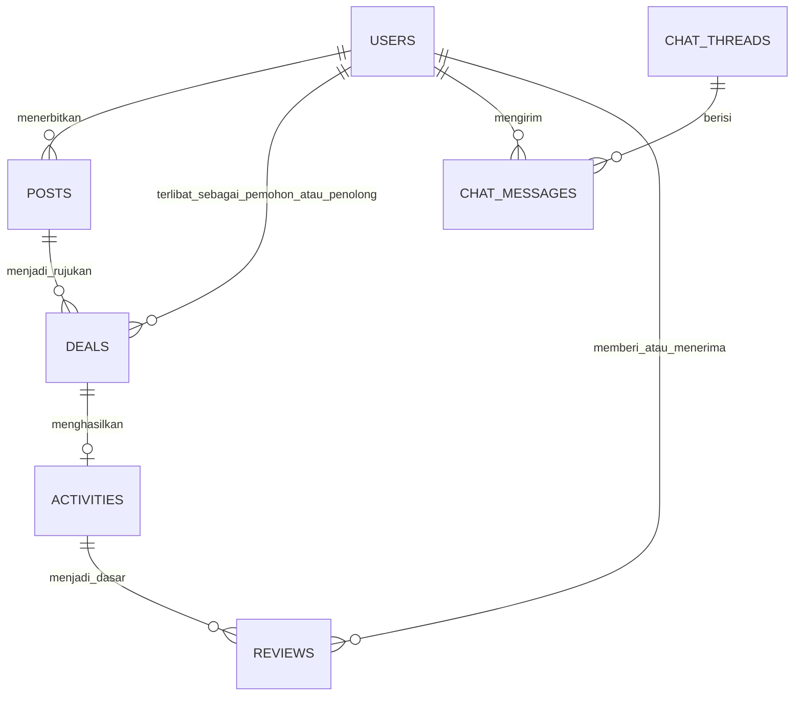

# Technical Specification (TECH_SPEC) — NeedHelp Jogja
**Status:** Draf Perancangan Teknis Arsitektur Multipengguna  
**Versi:** 2.0.0  
**Tanggal:** 26 Oktober 2026  
**Dasar Stack:** Next.js 15.5 (App Router, JavaScript), React 19.3, Node.js >= 22.12.0  

---

## 1. Arsitektur Sistem & Karakteristik Lingkungan

### 1.1 Kondisi Lingkungan Saat Ini
* **Framework:** Next.js 15.5.28 (App Router), React 19.3.1.
* **Hosting Produksi Saat Ini:** Server Node.js mandiri (VPS dengan IP `163.223.227.5`, PT Anym Network Indonesia) yang menyajikan domain `https://needhelpjogja.my.id/`.
* **Kebutuhan Baru:** Mengubah sistem dari penyimpanan browser lokal (`localStorage`) menjadi sistem multipengguna nyata di mana Pengguna A dan Pengguna B dapat berinteraksi lintas browser/perangkat melalui basis data terpusat.

---

## 2. Arsitektur Backend: Supabase (PostgreSQL + Supabase Auth + Realtime)

Berdasarkan keputusan pengguna, sistem menggunakan **Supabase** sebagai platform data terpusat, autentikasi, dan pembaruan realtime:

* **Integrasi SDK:** `@supabase/ssr` dan `@supabase/supabase-js`.
* **Mekanisme Sesi:** Berbasis Cookie yang dikelola secara transparan oleh `@supabase/ssr` pada server client (`cookies()` Next.js) dan browser client (`document.cookie`), dengan sinkronisasi sesi aktif melalui Next.js Middleware.
* **Variabel Lingkungan:**
  * `NEXT_PUBLIC_SUPABASE_URL` (URL proyek Supabase)
  * `NEXT_PUBLIC_SUPABASE_ANON_KEY` (Kunci publik aman untuk akses klien dengan proteksi RLS)
  * *Catatan Keamanan:* Kunci rahasia `service_role_key` **tidak digunakan di klien** dan tidak disimpan di Git.
* **Autentikasi:** Ditangani oleh Supabase Auth (`auth.users`). Kata sandi di-hash dan disimpan secara aman di skema internal `auth.users`, **tidak disimpan di tabel `public.profiles`**.
* **Sinkronisasi Profil:** Menggunakan trigger database PostgreSQL (`after insert on auth.users`) untuk membuat baris profil publik secara otomatis saat pendaftaran berhasil.

---

## 3. Skema Data Relasional Terpusat (*Data Schema*)

Berikut adalah skema tabel terpusat yang dirancang untuk mendukung kebutuhan multipengguna:



### 3.1 Tabel `profiles` (Profil Pengguna Publik)
Menyimpan informasi publik pengguna dan terhubung langsung ke `auth.users` Supabase:

```sql
CREATE TABLE public.profiles (
    id UUID PRIMARY KEY REFERENCES auth.users(id) ON DELETE CASCADE,
    email TEXT UNIQUE NOT NULL,
    full_name TEXT NOT NULL,
    bio TEXT DEFAULT '',
    avatar_url TEXT DEFAULT '',
    rating_average REAL DEFAULT 0.0,       -- Dihitung dinamis dari ulasan
    rating_count INTEGER DEFAULT 0,
    created_at TIMESTAMP WITH TIME ZONE DEFAULT timezone('utc'::text, now()) NOT NULL,
    updated_at TIMESTAMP WITH TIME ZONE DEFAULT timezone('utc'::text, now()) NOT NULL
);

-- Trigger otomatis untuk membuat baris profile saat pengguna baru mendaftar di auth.users
CREATE OR REPLACE FUNCTION public.handle_new_user()
RETURNS TRIGGER AS $$
BEGIN
    INSERT INTO public.profiles (id, email, full_name, avatar_url)
    VALUES (
        new.id,
        new.email,
        COALESCE(new.raw_user_meta_data->>'full_name', split_part(new.email, '@', 1)),
        COALESCE(new.raw_user_meta_data->>'avatar_url', '')
    );
    RETURN NEW;
END;
$$ LANGUAGE plpgsql SECURITY DEFINER;

CREATE OR REPLACE TRIGGER on_auth_user_created
    AFTER INSERT ON auth.users
    FOR EACH ROW EXECUTE FUNCTION public.handle_new_user();
```

### 3.2 Aturan Keamanan Tingkat Baris (Row Level Security - RLS)
Supabase mengamankan data secara langsung di level database melalui PostgreSQL RLS:

* **Tabel `profiles`:**
  * `SELECT`: Terbuka untuk umum (`true`) agar pengguna dapat saling melihat nama dan rating.
  * `INSERT`: Dikelola oleh trigger sistem (`on_auth_user_created`).
  * `UPDATE`: Hanya oleh pemilik akun (`auth.uid() = id`).
  * `DELETE`: Hanya oleh pemilik akun (`auth.uid() = id`).
* **Tabel `posts`:**
  * `SELECT`: Terbuka untuk umum (`true`).
  * `INSERT`: Wajib login (`auth.role() = 'authenticated'` dan `auth.uid() = author_id`).
  * `UPDATE / DELETE`: Hanya oleh pembuat postingan (`auth.uid() = author_id`).
* **Tabel `chat_threads`:**
  * `SELECT`: Hanya oleh peserta thread (`auth.uid() = user1_id OR auth.uid() = user2_id`).
  * `INSERT`: Wajib login dan menjadi salah satu peserta thread.
* **Tabel `chat_messages`:**
  * `SELECT`: Hanya oleh peserta thread yang bersangkutan.
  * `INSERT`: Hanya pengirim yang terotentikasi (`auth.uid() = sender_id`).
* **Tabel `deals`:**
  * `SELECT / UPDATE`: Hanya oleh pemohon atau penolong terkait (`auth.uid() = requester_id OR auth.uid() = helper_id`).
* **Tabel `activities`:**
  * `SELECT / UPDATE`: Hanya oleh pihak yang terlibat dalam kegiatan tersebut.
* **Tabel `reviews`:**
  * `SELECT`: Terbuka untuk umum (`true`).
  * `INSERT`: Hanya oleh peninjau yang terotentikasi (`auth.uid() = reviewer_id` dan `reviewer_id != reviewee_id`).

### 3.2 Tabel `posts` (Postingan Saya Butuh & Saya Bisa)
```sql
CREATE TABLE posts (
    id TEXT PRIMARY KEY,                   -- Contoh: 'post-1730000000-abc'
    author_id TEXT NOT NULL REFERENCES users(id),
    nature TEXT NOT NULL CHECK(nature IN ('butuh', 'bisa')),
    title TEXT NOT NULL,                   -- 5 - 100 karakter
    category TEXT NOT NULL CHECK(category IN ('ditemani', 'bantuan', 'pendampingan', 'explore')),
    description TEXT NOT NULL,            -- 20 - 1000 karakter
    planned_date DATE NOT NULL,            -- Tanggal pelaksanaan (>= hari ini)
    start_time TIME NOT NULL,
    end_time TIME,
    region TEXT NOT NULL CHECK(region IN ('sleman', 'kota', 'bantul', 'kulonprogo', 'gunungkidul')),
    address_general TEXT NOT NULL,         -- Titik temu umum publik (5 - 150 karakter)
    compensation_type TEXT NOT NULL CHECK(compensation_type IN ('tarif', 'nego', 'patungan', 'bayarsendiri', 'traktir', 'sukarela')),
    amount NUMERIC DEFAULT 0,              -- Nominal jika tarif pasti
    compensation_note TEXT DEFAULT '',
    quota INTEGER DEFAULT 1,               -- Jumlah orang yang dibutuhkan (khusus Saya Butuh)
    remaining_quota INTEGER DEFAULT 1,
    status TEXT NOT NULL DEFAULT 'aktif' CHECK(status IN ('aktif', 'kuota_penuh', 'ditutup', 'kedaluwarsa')),
    created_at TIMESTAMP DEFAULT CURRENT_TIMESTAMP
);
```

### 3.3 Tabel `chat_threads` & `chat_messages` (Percakapan Kontekstual)
```sql
CREATE TABLE chat_threads (
    id TEXT PRIMARY KEY,
    user1_id TEXT NOT NULL REFERENCES users(id),
    user2_id TEXT NOT NULL REFERENCES users(id),
    created_at TIMESTAMP DEFAULT CURRENT_TIMESTAMP,
    UNIQUE(user1_id, user2_id)
);

CREATE TABLE chat_messages (
    id TEXT PRIMARY KEY,
    thread_id TEXT NOT NULL REFERENCES chat_threads(id),
    sender_id TEXT NOT NULL REFERENCES users(id),
    message_type TEXT NOT NULL DEFAULT 'text' CHECK(message_type IN ('text', 'deal_card', 'system_event')),
    content TEXT NOT NULL,
    metadata JSON DEFAULT NULL,            -- Data rincian jika bertipe 'deal_card'
    created_at TIMESTAMP DEFAULT CURRENT_TIMESTAMP
);
```

### 3.4 Tabel `deals` (Kartu Kesepakatan)
```sql
CREATE TABLE deals (
    id TEXT PRIMARY KEY,
    post_id TEXT NOT NULL REFERENCES posts(id),
    thread_id TEXT NOT NULL REFERENCES chat_threads(id),
    requester_id TEXT NOT NULL REFERENCES users(id),
    helper_id TEXT NOT NULL REFERENCES users(id),
    scheduled_date DATE NOT NULL,
    scheduled_time TIME NOT NULL,
    meetup_location TEXT NOT NULL,
    compensation_type TEXT NOT NULL,
    compensation_value TEXT NOT NULL,
    requester_agreed BOOLEAN DEFAULT FALSE,
    helper_agreed BOOLEAN DEFAULT FALSE,
    deal_version INTEGER DEFAULT 1,        -- Bertambah jika ada perubahan parameter
    status TEXT NOT NULL DEFAULT 'diajukan' CHECK(status IN ('diajukan', 'menunggu_revisi', 'disepakati', 'ditolak', 'dibatalkan')),
    created_at TIMESTAMP DEFAULT CURRENT_TIMESTAMP,
    updated_at TIMESTAMP DEFAULT CURRENT_TIMESTAMP
);
```

### 3.5 Tabel `activities` (Siklus Kegiatan Riil)
```sql
CREATE TABLE activities (
    id TEXT PRIMARY KEY,
    deal_id TEXT UNIQUE NOT NULL REFERENCES deals(id),
    post_id TEXT NOT NULL REFERENCES posts(id),
    requester_id TEXT NOT NULL REFERENCES users(id),
    helper_id TEXT NOT NULL REFERENCES users(id),
    status TEXT NOT NULL DEFAULT 'terjadwal' CHECK(status IN ('terjadwal', 'berlangsung', 'selesai', 'batal')),
    cancellation_reason TEXT DEFAULT '',
    completed_at TIMESTAMP,
    created_at TIMESTAMP DEFAULT CURRENT_TIMESTAMP
);
```

### 3.6 Tabel `reviews` (Rating & Ulasan Reputasi)
```sql
CREATE TABLE reviews (
    id TEXT PRIMARY KEY,
    activity_id TEXT NOT NULL REFERENCES activities(id),
    reviewer_id TEXT NOT NULL REFERENCES users(id),
    reviewee_id TEXT NOT NULL REFERENCES users(id),
    stars INTEGER NOT NULL CHECK(stars BETWEEN 1 AND 5),
    comment TEXT NOT NULL,                 -- 10 - 500 karakter
    created_at TIMESTAMP DEFAULT CURRENT_TIMESTAMP,
    UNIQUE(activity_id, reviewer_id)       -- 1 kali ulasan per pihak per kegiatan
);
```

---

## 4. Kontrak API & Rute Server Next.js (App Router)

Seluruh endpoint server diletakkan di `src/app/api/`:

| Endpoint | Method | Fungsi | Otorisasi |
|---|---|---|---|
| `/api/auth/register` | `POST` | Mendaftarkan pengguna baru dengan email & password. | Publik |
| `/api/auth/login` | `POST` | Memvalidasi kredensial dan menerbitkan sesi. | Publik |
| `/api/auth/me` | `GET` | Membaca data profil pengguna yang sedang login. | Wajib Login |
| `/api/posts` | `GET` | Membaca feed postingan dengan query filter (type, category, region, q). | Publik |
| `/api/posts` | `POST` | Menerbitkan postingan baru (Saya Butuh / Saya Bisa). | Wajib Login |
| `/api/posts/[id]` | `GET` | Membaca detail satu postingan beserta info publik author. | Publik |
| `/api/chats` | `GET` | Membaca daftar obrolan aktif milik pengguna login. | Wajib Login |
| `/api/chats/[threadId]/messages` | `GET`, `POST` | Membaca riwayat pesan dan mengirim pesan baru/kartu deal. | Anggota Thread |
| `/api/deals/[dealId]/action` | `POST` | Mengajukan, menyetujui, atau merevisi kartu kesepakatan. | Anggota Deal |
| `/api/activities` | `GET` | Membaca daftar kegiatan pengguna (terjadwal, berlangsung, selesai). | Wajib Login |
| `/api/activities/[id]/action` | `POST` | Konfirmasi selesai atau membatalkan kegiatan. | Pihak Kegiatan |
| `/api/reviews` | `POST` | Mengirim ulasan untuk kegiatan berstatus `selesai`. | Pihak Kegiatan |

---

## 5. Autentikasi, Sesi, dan Otorisasi

1. **Pengelolaan Sesi:**
   * Token sesi disimpan menggunakan HTTP-Only Cookie yang aman (`needhelp_session`), mencegah pencurian token via skrip XSS di sisi klien.
2. **Otorisasi Server-Side:**
   * Setiap request mutasi data (`POST`, `PUT`, `DELETE`) divalidasi di level Route Handler Next.js.
   * Server memeriksa apakah `userId` dari sesi cocok dengan pihak yang berhak mengubah status posting, kesepakatan, atau ulasan.
3. **Peran `localStorage`:**
   * Dibatasi murni untuk caching non-kritis dan preferensi UI lokal:
     * Draf isian form yang belum di-submit.
     * Riwayat pencarian terakhir pengguna di browser tersebut.
     * Status minimize/maximize pada jendela docked mini-chat.
